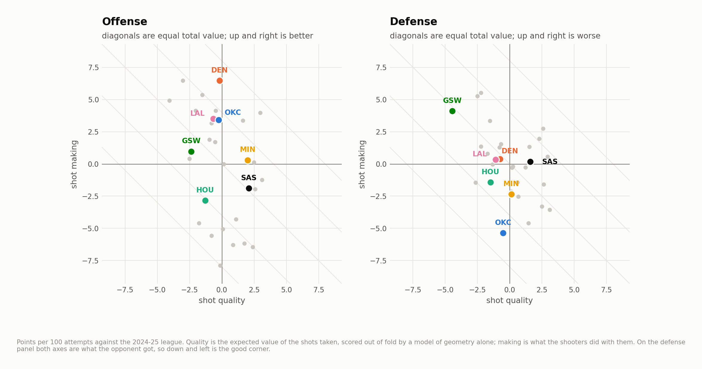
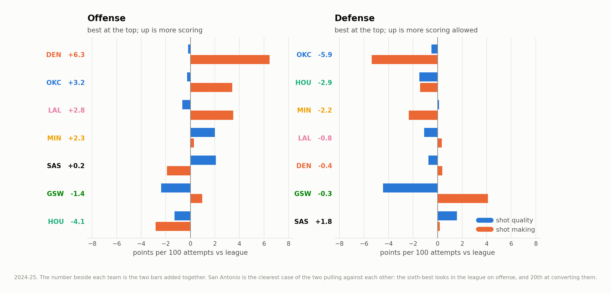
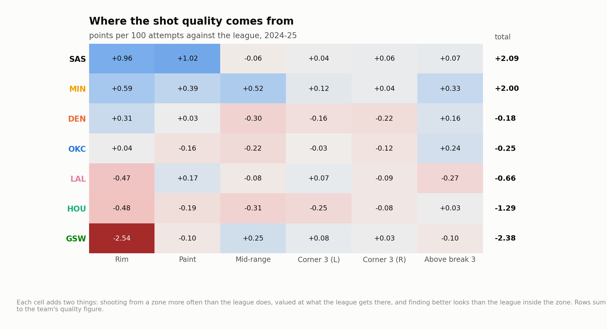
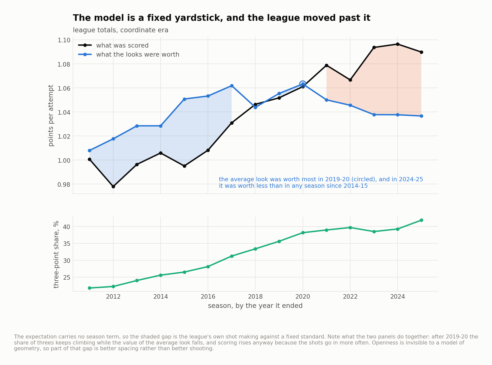

# The half of a contender you can scout in a week

San Antonio's road out of the West runs through Oklahoma City and four or five
other teams that were all better than them in 2024-25. This takes the last full
season the public shot-chart mirror covers and splits each of those offenses and
defenses into two numbers: the value of the **looks** a team generated, and what
its shooters **did** with them.

Fifteen seasons, 3,060,130 attempts, 17,884 games, 450 team-seasons, 2010-11 to
2024-25.

**Shot quality is legible after about a week of basketball. Shot making is a real
team trait that takes most of a season to see — and a seven-game series is not a
season. Over 622 attempts, the resampling band for the league's best shot-making
offense overlaps the band for its worst.**

---

## The two numbers

Every attempt gets an expected value, xPPS: the points a league-average shooter
would be expected to score from that spot, scored by a gradient-boosted model of
geometry that never saw the game the shot came from. Aggregate over a team's
season and the arithmetic splits cleanly:

```
quality = team expected  -  league expected          the looks
making  = (team actual - team expected) - (league actual - league expected)
total   = team actual    -  league actual            = quality + making
```

All three are points per 100 attempts against that season's league. Nothing is
per possession — this file has no free throws, no turnovers and no offensive
rebounds, and pretending otherwise would be inventing data.



The first thing the picture says is that the two axes are not the same size. In
2024-25 the standard deviation across the thirty teams was **1.90 on quality and
4.29 on making**. Nine of the ten best offenses in the league got there mainly on
making. Whatever era of shot-selection arbitrage produced the 2015-20 three-point
boom, it is over: teams no longer separate themselves much by *where* they shoot.

---

## The seven teams



| | Offense: quality | making | total | Defense: quality | making | total |
|---|---|---|---|---|---|---|
| **San Antonio** | **+2.09** (6th) | −1.89 (20th) | +0.19 | +1.58 (24th) | +0.18 | +1.76 (23rd) |
| Oklahoma City | −0.25 | +3.42 | +3.17 (7th) | −0.51 (14th) | **−5.37** (1st) | **−5.88** (1st) |
| Denver | −0.18 | **+6.46** (2nd) | +6.28 (2nd) | −0.76 | +0.39 | −0.37 |
| Minnesota | +2.00 (7th) | +0.29 | +2.30 | +0.12 | −2.35 | −2.23 (5th) |
| LA Lakers | −0.66 | +3.50 | +2.84 | −1.10 | +0.34 | −0.76 |
| Golden State | −2.38 (27th) | +0.97 | −1.41 | **−4.46** (1st) | +4.11 (28th) | −0.34 |
| Houston | −1.29 | −2.84 | −4.12 (24th) | −1.49 | −1.43 | −2.92 (4th) |

*(Defense is what the opponent got, so on that side negative is good.)*

Three of these are worth saying out loud.

**San Antonio built the sixth-best set of looks in the league and finished 20th
at converting them.** Their offense was almost exactly league average overall,
and none of that was shot selection.

**Oklahoma City's historic defense is 91% conversion.** They forced the 14th-best
shot chart in the league and then held opponents 5.37 points per 100 below what
those shots were worth — first by a distance. A coarser five-zone version of the
same split lives in the sibling `okc-defence` repo and lands in the same place.

**Golden State forced the worst looks in the NBA and gave four points of it
back.** Best shot chart in the league, 28th in conversion allowed, net nothing.
That is either the most unlucky defense of the season or a defense whose scheme
concedes something the geometry cannot see. The next section is about telling
those two apart, and it does not fully manage it.

---

## How long each half takes to see

Take a team-season, split its attempts at random into two disjoint halves,
measure both numbers on each half, and correlate across teams. Repeat, and vary
how many attempts each half gets.


| Attempts in each half | Quality repeats at | Making repeats at |
|---|---|---|
| 150 (under two games) | 0.56 | 0.13 |
| 622 (a seven-game series) | **0.84** | **0.38** |
| 1,100 (about a quarter of a season) | 0.90 | 0.52 |
| 2,536 (half a season) | 0.96 | 0.71 |

Stepped up to full-season length with Spearman-Brown, a season measures quality
at **0.98** and making at **0.83** — so over 82 games, both are real. Making is
not noise. It is just slow.

And then the part that surprised me. Correlate a franchise's season against its
next one across 418 consecutive pairs, and divide by the within-season
reliability to separate *how much a team keeps* from *how well one season
measures it*:

| | Raw year-to-year | Corrected for measurement |
|---|---|---|
| Offensive quality | 0.63 | **0.64** |
| Offensive making | 0.65 | **0.78** |
| Defensive quality | 0.74 | **0.76** |
| Defensive making | 0.53 | **0.79** |

Once you account for how imprecisely one season measures it, **shot making is
the more persistent trait on both sides of the ball**. Shot selection is a scheme
choice and schemes change every summer; shooting talent is roster-sticky, and
part of what lands in "making" is a team's ability to manufacture openness the
geometry cannot see. Which is a caveat and a finding at the same time, and I have
not found a way to separate them with this data.

---

## What seven games does to it

Resample 622 attempts — the league's 88.9 attempts per team-game, times seven —
from each team's own 2024-25 season, with replacement, four thousand times.
Nothing changes but how much of the team you get to see.


The average band is **4.74 points per 100 wide** in standard deviation. The
spread of true team making talent across the league, after subtracting the
sampling variance, is **4.06**. The noise in a single series is larger than the
entire distribution of the skill. Twenty-nine of the thirty bands cover zero, and
the top band overlaps the bottom one.

So: shrink each team's making by the reliability its sample earns, and see what
moves. At season length the reliability is 0.83 and almost nothing moves — a
maximum of three places. At series length it is 0.38:

| Biggest risers | | Biggest fallers | |
|---|---|---|---|
| Atlanta | +10 | Phoenix | −10 |
| Chicago | +9 | Indiana | −8 |
| **San Antonio** | **+8** | LA Clippers | −6 |
| Minnesota | +5 | Sacramento | −6 |

San Antonio's offense was 18th on the season and is 10th once making is trusted
only as far as 622 attempts allow. That is not a claim that they were unlucky. It
is a claim about which of the two numbers a seven-game sample is entitled to move.

---

## Where San Antonio's looks come from



Each cell adds two things: shooting from a zone more than the league does, priced
at what the league gets there, and finding better looks than the league inside
the zone. Rows sum to the team's quality figure.

San Antonio's entire +2.09 is **inside the arc**: +0.96 at the rim and +1.02 in
the paint off it, with the three-point zones contributing +0.17 between them.
Minnesota's +2.00 is spread across every zone on the floor. Golden State's −2.38
is one cell: **−2.54 at the rim**, the largest single-zone deficit among the
seven, and everything else they do is close to league average.

That is a scouting note with a shape. A team whose quality edge is one zone deep
is a team an opponent can attack in one adjustment.

---

## Why the model reads geometry and nothing else

The model carries no season term and no action type, and both omissions are
deliberate.

No season term, because the whole decomposition depends on the yardstick staying
still while the league moves:



The average NBA look was worth most in **2019-20** and by 2024-25 was worth less
than in any season since 2014-15 — while the three-point share climbed from 38%
to 42% and scoring went up anyway. The league is taking *more* threes from
*worse* places and making more of them. How much of that is better shooting and
how much is better spacing, this data cannot say.

No action type, because the labels moved underneath the sample. Between 2014-15
and 2015-16 the share of attempts logged as a plain "Jump shot" fell seven points
in a single off-season and "Floater" more than doubled; across the fifteen years,
"Layup" went from 12.7% of all attempts to 1.6% and "Pull-up" from 2.4% to 13.0%.
Players did not change that fast. The vocabulary did. `output/action_labels.csv`
has the whole table.

The model that *does* read action type is fit anyway, as a sensitivity check.
Across the thirty 2024-25 teams the two agree at r = 0.93 to 0.99 depending on
the component, with a mean gap of 0.35 to 0.50 points per 100 and a worst-case
move of eleven places on offensive quality. Every claim above survives it;
`output/spec_sensitivity.csv` is the receipt.

Fit quality, out of fold with folds grouped by game, 3.06 million attempts:

| | Log loss | Brier | AUC |
|---|---|---|---|
| Geometry only | 0.6534 | 0.2308 | 0.634 |
| Plus action type, clock, venue | 0.6361 | 0.2235 | 0.665 |
| League make rate, constant | 0.6902 | 0.2485 | 0.500 |

Across twenty equal-count bins the geometry model's predicted and observed make
rates differ by at most 0.0024.

---

## What this is not

- **Not an offensive rating.** Per attempt, never per possession. Free throws,
  turnovers and offensive rebounds are all outside the file.
- **Openness is invisible.** No defender data exists in a public shot file, so
  every point of value a team creates by getting a shooter *open* is scored as
  shot making rather than shot quality. This is the reason the making component
  persists as well as it does, and nothing here separates the spacing from the
  shooting.
- **The series arithmetic is a floor, not a forecast.** Resampling a team's own
  regular-season attempts holds its shot distribution fixed. A playoff opponent
  changes that distribution deliberately, which adds uncertainty rather than
  removing it.
- **Regular season only, through 2024-25**, which is where the mirror ends. The
  seven-game figure is 622 regular-season attempts, not a playoff series.
- **Team abbreviations, not franchises.** The year-over-year pairs break at New
  Jersey's move to Brooklyn and New Orleans' rename, which is why there are 418
  pairs and not 420.

---

## Running it

```bash
pip install -r requirements.txt
python src/run_01_build.py   # 15 season files -> 3.06M model-ready attempts
python src/run_02_model.py   # two specifications, scored out of fold        (~5 min)
python src/run_03_teams.py   # the decomposition, reliability, figures 01-06 (~5 min)
```

Or `make all`. `make figures` re-cuts every chart from the tables already in
`output/` without refitting anything.

```
src/
  config.py       paths, seasons, the seven teams, the sample floors
  features.py     raw rows -> geometry, including the coordinate repair
  model.py        the two specifications and the out-of-fold fit
  quality.py      the decomposition, split-half reliability, the series resample
  figures.py      every chart, drawn from the tables and nothing else
  style.py        one place that decides what a figure looks like
  run_0*.py       the pipeline, in order
output/           every number quoted above, as CSV
figures/          six figures, regenerated from scratch by the pipeline
docs/method.md    the longer argument, including what shot making is really made of
```

## Data

Shot-level data from
[DomSamangy/NBA_Shots_04_24](https://github.com/DomSamangy/NBA_Shots_04_24), a
mirror of the league's public shot chart endpoint. `data/README.md` has the fetch
step, the coordinate repair, and the list of things a shot file cannot see.

## License

MIT. See `LICENSE`.
