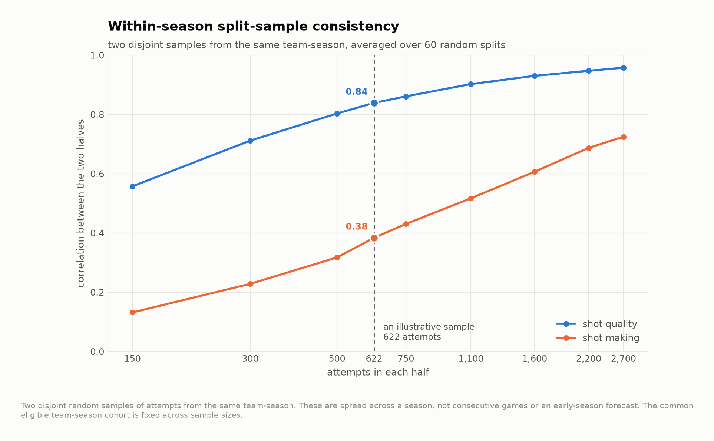
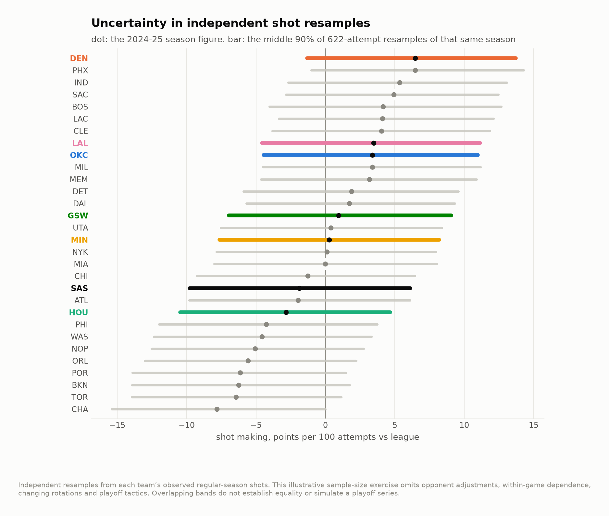

# Comparing team shot expectations and residual conversion

A team can score efficiently because of the attempts it generates, how it converts them, or both. This study separates a shot-model expectation from actual-minus-expected scoring and compares selected Western teams in the 2024–25 regular season. “Contender” is the historical project label, not a current championship forecast.

## The historical comparison

Values below are points per 100 field-goal attempts relative to the season's league baseline. For the defensive rows, lower opponent scoring is better. The ranks are within that season's source sample.

| Side | Team | Attempts | Quality | Making | Total | Quality rank | Making rank |
|---|---|---|---|---|---|---|---|
| offence | DEN | 7,307 | -0.184 | 6.467 | 6.283 | 14.000 | 1.000 |
| offence | GSW | 7,371 | -2.365 | 0.959 | -1.406 | 27.000 | 14.000 |
| offence | HOU | 7,623 | -1.293 | -2.830 | -4.123 | 23.000 | 22.000 |
| offence | LAL | 6,973 | -0.633 | 3.474 | 2.841 | 19.000 | 8.000 |
| offence | MIN | 7,151 | 2.026 | 0.269 | 2.295 | 7.000 | 16.000 |
| offence | OKC | 7,581 | -0.212 | 3.384 | 3.172 | 16.000 | 9.000 |
| offence | SAS | 7,328 | 2.070 | -1.876 | 0.194 | 6.000 | 20.000 |
| defence | DEN | 7,597 | -0.741 | 0.373 | -0.368 | 12.000 | 18.000 |
| defence | GSW | 7,090 | -4.443 | 4.099 | -0.344 | 1.000 | 28.000 |
| defence | HOU | 7,213 | -1.481 | -1.436 | -2.918 | 8.000 | 10.000 |
| defence | LAL | 7,282 | -1.115 | 0.350 | -0.764 | 10.000 | 17.000 |
| defence | MIN | 7,178 | 0.146 | -2.379 | -2.233 | 16.000 | 6.000 |
| defence | OKC | 7,098 | -0.502 | -5.375 | -5.876 | 14.000 | 1.000 |
| defence | SAS | 7,555 | 1.571 | 0.187 | 1.758 | 24.000 | 16.000 |

Source: [contenders.csv](output/contenders.csv).

The residual includes factors missing from the public shot model, including openness and defensive pressure. It is not a direct measurement of shooting skill or luck. Free throws, turnovers, rebounding and total possession efficiency are outside this field-goal decomposition.

## How the model is evaluated

| Specification | Log loss | Brier score | ROC AUC |
|---|---|---|---|
| Geometry model | 0.653 | 0.231 | 0.634 |
| Recorded-context model | 0.636 | 0.224 | 0.665 |
| Constant-probability baseline | 0.690 | 0.249 | 0.500 |

Source: [model_fit.csv](output/model_fit.csv).

Game-grouped folds separate each scored shot from other shots in its game. The model evaluation is within the historical sample, not a pre-season or playoff forecast. The source coordinates and action labels require the documented era restrictions and sensitivity checks.

## What the resampling can establish



Random subsets of the same team-season describe within-season consistency across sample sizes. They do not reproduce consecutive games or an unfamiliar playoff opponent.



The bands resample individual regular-season attempts independently. Their sample size is chosen to resemble several games' worth of shots, but they omit game-level dependence, tactical adjustments, injuries and rotation changes. They are an illustrative sampling exercise, not playoff-series outcome probabilities. Overlap between bands is not a formal equivalence test.

Reliability-based shrinkage tables remain available as a sensitivity exercise. Applying a smaller-sample coefficient to a season estimate is a hypothetical adjustment, not evidence that the adjusted value predicts a series.

## Basketball use

These components help frame a scouting question: is the observed field-goal advantage associated with the available shot features or with conversion beyond them? Follow that question with film and possession-level measures before recommending a coverage change.


## Reproduce

The historical analysis used Python 3.12 with the pinned dependencies below. From this repository:

```bash
python3.12 -m venv .venv
source .venv/bin/activate
python -m pip install -r requirements.txt
make fetch-data PY=python
make all PY=python
make report site PY=python
```

`make all` verifies source hashes before running the analyses in order. A missing or changed input stops the build. Data downloads need network access; article rendering uses the included result tables. See [the source manifest](data/source_manifest.json), [method notes](docs/method.md) and [current validation record](VALIDATION_CURRENT.md) for the distinction between a source rebuild and checks of delivered outputs.

Season keys in CSV files use the **ending year**: `2025` means 2024–25. Display tables use full season labels. The MIT license covers code; third-party data retain their providers' rights and terms.

[Portfolio](https://github.com/jmsmarrelli/basketball-analytics) · [AI assistance and provenance](PROVENANCE.md)
